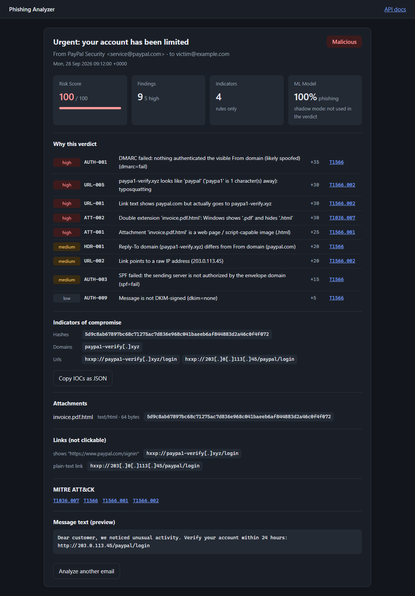
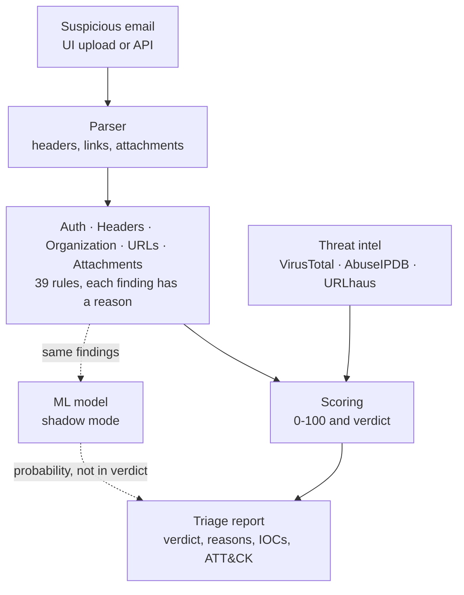

# Phishing Analyzer

[](https://github.com/saifeddineDallelou/phishing-analyzer/actions/workflows/ci.yml)
[](https://github.com/saifeddineDallelou/phishing-analyzer/releases)
[](https://github.com/saifeddineDallelou/phishing-analyzer/pkgs/container/phishing-analyzer)

[](LICENSE)

**An explainable phishing triage service.** Drop a suspicious email, get a verdict with the evidence
behind it: which checks failed, why it matters, the indicators to block and the MITRE ATT&CK
techniques involved. Built for the questions a SOC analyst actually asks, not just a score.



## Highlights

- **39 explainable detection rules** across authentication (SPF/DKIM/DMARC), header spoofing and
  BEC, URLs, attachments and organization-specific impersonation, each mapped to MITRE ATT&CK
- **Threat intelligence** from VirusTotal, AbuseIPDB and URLhaus, in parallel, cached, and never
  sending file contents
- **Machine learning in shadow mode**, with a documented dataset bias that a 97% test score was hiding
- **Secure by design**: XSS-safe report UI with a strict CSP, hardened non-root container, secrets
  kept out of git and images
- **CI/CD**: every PR is tested and its container smoke-tested; every release is published to GHCR
  with a signed, verifiable build provenance

## Try it in one minute

```bash
docker run --rm -p 127.0.0.1:8000:8000 ghcr.io/saifeddinedallelou/phishing-analyzer:latest
```

Open http://127.0.0.1:8000 and drop [`tests/samples/phishing_example.eml`](tests/samples/phishing_example.eml)
(a harmless fake). The API is documented at http://127.0.0.1:8000/docs.

Verify the image was built by this repository's CI before running it:

```bash
gh attestation verify oci://ghcr.io/saifeddinedallelou/phishing-analyzer:latest --owner saifeddineDallelou
```

## How it works



Every analyzer returns findings with a rule ID, a human-readable reason, a severity, a score and
an ATT&CK technique. The reasons are the point: *"DMARC failed + link text shows paypal.com but goes
to paypa1-verify.xyz + `invoice.pdf.html` attachment"* is something an analyst can act on;
*"score 85"* is not.

## Detection rules

| Area | Rules | Examples |
|---|---|---|
| Authentication | AUTH-001 … 009 | DMARC fail, SPF fail/softfail, missing DKIM; only our own server's `Authentication-Results` is trusted |
| Headers | HDR-001 … 006 | Brand name on a free-webmail address, fake address in the display name, homoglyphs, phishing-kit fingerprints |
| Organization | ORG-001 … 003 | VIP or internal-service name from outside (BEC), lookalikes of the organization's own domain |
| URLs | URL-001 … 010 | Link text that lies, raw IPs, `@` trick, punycode, typosquatting (Damerau-Levenshtein), brand in subdomain, redirects |
| Attachments | ATT-001 … 007 | Magic bytes vs extension, double extension, RTLO, VBA auto-exec macros (oletools), encrypted archive with password in body |
| Threat intel | INTEL-001 … 004 | Known-malicious hash/domain/URL, domain registered days ago, abusive sending IP |

Some rules were deliberately **not** written. A Return-Path ≠ From check, for example, would flag
most legitimate newsletters (they bounce through their mailing provider) and DMARC alignment already
covers its useful part. The reasoning is documented next to the code.

## Machine learning, and the bias it uncovered

A logistic regression learns how much to trust each rule, from 3,803 real emails: 1,303 phishing
emails ([Nazario corpus](https://monkey.org/~jose/phishing/), 2023-2025) and 2,500 legitimate ones
([SpamAssassin corpus](https://spamassassin.apache.org/old/publiccorpus/), 2003).

The first model scored **97% precision / 96% recall** on held-out data, and was wrong. The legitimate
emails predate DKIM/DMARC and HTML-only mail, so it had learned *"modern email = phishing"*. Testing on
real, recent legitimate emails exposed it:

| Real legitimate email | First model | Shipped model | Rules |
|---|---|---|---|
| Recruiter reply (HTML-only) | 99% phishing | 22% | clean |
| WhatsApp verification code | 97% phishing | 97% phishing | clean |
| GitHub security notice | 34% | 46% | clean |

Era-dependent features were removed (shipped model: 86.5% precision / 82.8% recall, ROC AUC 0.95).
It still over-scores legitimate security notifications ("verify your account" + links) because it
only knows what *bad* looks like, with no trust features yet. So it runs in **shadow mode**: its
probability is shown, the rules decide. The model ships as plain JSON weights, never a pickle, so
loading it cannot execute code.

```bash
python -m scripts.train_model --exclude AUTH- HDR-004 html_only    # needs data/ (not in the repo)
python -m scripts.score_emails data/modern_legit --model models/phishing_model.json
```

## Security design

| Concern | What the project does |
|---|---|
| Attacker-controlled text in the UI | Inserted only as text nodes (a test fails if `innerHTML` & co. appear), strict CSP, `frame-ancestors 'none'` |
| Accidental clicks | IOCs and links are defanged (`hxxp://evil[.]xyz`) and never clickable; RTLO characters are revealed |
| Malicious files | Parsed and inspected statically only (magic bytes, `oletools`, ZIP listings): nothing is extracted or executed |
| Container | Non-root user, read-only filesystem, all capabilities dropped, no privilege escalation, bound to localhost |
| Secrets | API keys only in a git-ignored `.env`, passed at run time, wrapped in `SecretStr`; tests can never call real APIs |
| Privacy | Real phishing corpora and personal emails live in git-ignored `data/`; threat intel sends hashes, never files |
| Supply chain | Least-privilege workflows, Dependabot, signed build provenance on every published image |

## Development

```bash
python -m venv .venv
.venv\Scripts\activate          # Windows
pip install -r requirements-dev.txt
pytest                          # 109 tests
uvicorn app.main:app --reload   # http://127.0.0.1:8000
```

Optional configuration:

- **Threat intel:** copy `.env.example` to `.env` and add free API keys for VirusTotal, AbuseIPDB and
  URLhaus. Missing keys just disable that service. `python -m scripts.check_keys` tests them without
  printing them.
- **Organization profile:** copy `config/organization.example.json` to `config/organization.json`
  (git-ignored) to detect impersonation of your own VIPs, departments and domain.

Workflow: every change goes through a Pull Request; `main` is protected and requires the `tests`
and `docker` checks. Merges to `main` publish `ghcr.io/…:main`; tags `vX.Y.Z` publish `X.Y.Z` and
`latest`.

```
app/
  parser.py          raw .eml -> structured email
  analyzers/         auth, headers, organization, urls, attachments (the rules)
  intel/             IOC extraction, VirusTotal / AbuseIPDB / URLhaus clients, cache
  ml/                features, dataset loader, JSON model runtime
  static/            web UI (HTML/CSS/JS, no framework)
  main.py            FastAPI app, security headers
scripts/             train_model, score_emails, check_keys
tests/               109 tests, fake samples only
```

## Roadmap

- [ ] Trust features (aligned DMARC pass, known senders) and modern legitimate data, then let the model vote
- [ ] Own DKIM verification and SPF/DMARC record lookups
- [ ] IOC export to MISP, cases to TheHive, SOAR integration
- [ ] Demo mode (no uploads of real mail, rate limiting) and continuous deployment
- [ ] Multi-tenant admin console: accounts with MFA, DNS domain verification, mailbox connectors

## License and credits

Code released under the [MIT License](LICENSE).

Phishing training data: Jose Nazario's phishing corpus (CC BY 4.0). Legitimate training data:
Apache SpamAssassin public corpus. Neither is redistributed in this repository. Only the fake
samples in `tests/samples/` are committed; never open real phishing links or attachments on your host.
